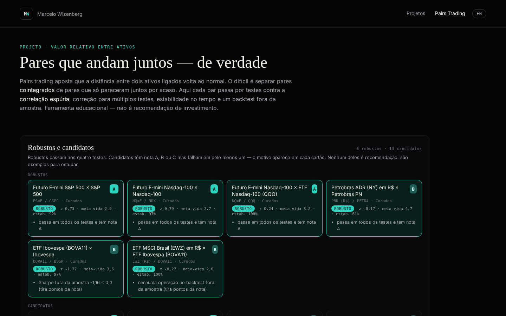

# Pairs Trading · valor relativo entre ativos

**▶ Abrir o app: [celowiz.github.io/pairs-trading](https://celowiz.github.io/pairs-trading/)**

[](https://celowiz.github.io/pairs-trading/)

Ferramenta **educacional** do portfólio de [Marcelo Wizenberg](https://celowiz.github.io/). Não é recomendação de investimento.

## O que faz
*Pairs trading* aposta que a distância (o *spread*) entre dois ativos ligados volta ao normal. A parte difícil é separar pares que andam juntos de verdade (**cointegrados**) de pares que só pareceram juntos por acaso. A página passa cada par por uma bateria de testes e mostra:

- **Robustos**: passam em todos os testes; **candidatos**: têm nota A, B ou C mas falham em pelo menos um (o motivo aparece no cartão).
- Ranking filtrável (classe, grupo, faixa, só spreads esticados com |z| ≥ 2) e, opcionalmente, os pares **sem vínculo econômico** (exploratório).
- Detalhe de cada par: spread e z-score, hedge ratio móvel, estabilidade da cointegração no tempo e backtest fora da amostra.
- PT/EN.

## Método (funil)
1. **Vínculo econômico primeiro**: só entram pares do mesmo setor/classe (`scripts/universe.py`) e uma lista curada de pares cruzados (ex.: PETR3 × PETR4, índice × futuro, ação × ADR convertido em R$). Testar todas as combinações geraria muitos falsos positivos.
2. **Correlação dos retornos ≥ 0,3**.
3. **Cointegração**: Engle-Granger nos dois sentidos + Johansen, numa janela de formação de 756 pregões (~3 anos).
4. **Correção para múltiplos testes**: Benjamini-Hochberg a 5% (FDR), porque com centenas de testes alguns passam por sorte.
5. **Meia-vida** do spread entre 2 e 60 dias.
6. **Estabilidade**: cointegração em ≥ 60% das janelas móveis de 252 pregões; *drift* do hedge ratio < 35%.
7. **Backtest walk-forward fora da amostra** com custo de 0,1% na entrada e na saída: entra com |z| ≥ 2, sai com |z| ≤ 0,5, stop em |z| ≥ 4 ou por tempo (3× a meia-vida).

Exemplo real do funil (dados até 23/10/2026, `data/meta.json`): 126 ativos → 306 pares com vínculo econômico → 269 com correlação → 41 cointegrados a 5% → 19 após o FDR → 6 robustos e 13 candidatos.

## Dados
- **Fonte**: Yahoo Finance (`yfinance`), fechamentos diários de ações BR e EUA, ETFs, futuros de juros e commodities e o câmbio USD/BRL (para pares ADR × ação local em R$).
- `data/` não é versionado: o workflow `.github/workflows/deploy.yml` baixa os fechamentos e gera os JSON a cada push, manualmente e de segunda a sexta às 19:17 (Brasília), com um cron reserva às 21:17 que só refaz o build se o principal ainda não tiver publicado. O download do Yahoo tem novas tentativas com espera crescente, e datas posteriores a hoje (Brasília) são descartadas.
- Arquivos gerados: `pairs.json`, `meta.json`, `pair/*.json` e `unlinked.json` (carregado sob demanda: pares sem vínculo e o FDR recalculado sobre todos os testes).
- `scripts/summary.py` grava `data/summary.json` (~3 KB: funil, pares robustos com z-score atual e candidatos mais afastados), lido pela página [Mercado Hoje](https://celowiz.github.io/mercado-hoje/) do portfólio.

## Rodar localmente
```bash
pip install -r requirements.txt
python -m pytest -q tests
python scripts/fetch.py prices.pkl
mkdir -p data && python scripts/build.py prices.pkl data
python scripts/summary.py data
python -m http.server 8000   # http://localhost:8000
```

## Detalhes técnicos
- Faixas: `robust` / `cand` (nota A–C sem passar nos 4 testes) / `other`.
- GA4 `G-QCBFGR39WG`, content_group `pairs_trading`; eventos `pairs_select(asset, source)`, `pairs_filter`/`pairs_sort(control, value)`, `filter_tier(control, value)`, `toggle_econ_filter(control=econ_filter, value on/off)`, `pairs_lang(value)`, `pairs_sim(value)`, `pairs_section(section)`.
- Favicon: opção A (design/favicons/pairs-trading/option_A.svg) + favicon-32.png, favicon.ico, apple-touch-icon.png.

## Licença
Código sob licença [MIT](LICENSE). Dados do Yahoo Finance seguem os termos da fonte.
